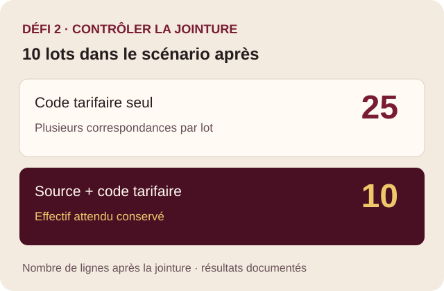

## Contexte et production

L’analyse compare les surtaxes simulées pour une commande fictive de dix lots avant et après un changement tarifaire. J’ai utilisé R pour préparer les tables et Quarto pour présenter la démarche et les résultats.

{.realisation-visuel}

## Le choix technique

Un même code tarifaire peut apparaître dans plusieurs tables. La jointure sur le code seul a produit 25 lignes pour le scénario après, alors que j’en attendais 10. La paire `source_table` et `code_tarifaire` identifie le tarif dans la bonne table. J’ai traité le code comme du texte pour conserver ses zéros initiaux.

| Contrôle | Résultat documenté |
|---|---|
| Effectif après jointure | 10 lots par scénario avec la clé composite. |
| Calcul indépendant | Pour L01, 40 000 × 50 % donne 20 000 CAD. |
| Valeur inconnue | Le montant de L10 est conservé comme manquant. |
| Sous-total des neuf lots calculables | 32 500 CAD avant et 61 750 CAD après, soit un écart de 29 250 CAD. |

## Essayer une jointure

Cet exemple utilise **trois lots et des tarifs fictifs** pour rendre le mécanisme visible. Dans le rapport du Défi 2, les effectifs documentés sont de 25 lignes avec le code seul et de 10 avec la clé composite pour le scénario après.

```{=html}
<div class="jointure-demo" data-jointure-demo>
  <div class="demo-tables">
    <div>
      <h3>Les lots</h3>
      <table>
        <caption>Trois lots fictifs</caption>
        <thead><tr><th>Lot</th><th>Source</th><th>Code</th></tr></thead>
        <tbody>
          <tr><td>L01</td><td>A</td><td>001</td></tr>
          <tr><td>L02</td><td>B</td><td>001</td></tr>
          <tr><td>L03</td><td>A</td><td>002</td></tr>
        </tbody>
      </table>
    </div>
    <div>
      <h3>Les tarifs</h3>
      <table>
        <caption>Tarifs fictifs de deux sources</caption>
        <thead><tr><th>Source</th><th>Code</th><th>Taux</th></tr></thead>
        <tbody data-demo-tarifs>
          <tr><td>A</td><td>001</td><td>10 %</td></tr>
          <tr><td>B</td><td>001</td><td>20 %</td></tr>
          <tr><td>A</td><td>002</td><td>5 %</td></tr>
        </tbody>
      </table>
    </div>
  </div>
  <div data-demo-commandes hidden>
    <fieldset class="demo-cle">
      <legend>Choisir la clé de jointure</legend>
      <label><input type="radio" name="cle-jointure" value="code"> Code seul</label>
      <label><input type="radio" name="cle-jointure" value="composite" checked> Source + code</label>
    </fieldset>
    <label class="demo-doublon"><input type="checkbox" data-demo-doublon> Ajouter un doublon exact A + 001 dans les tarifs</label>
  </div>
  <div data-demo-resultat hidden>
    <p class="demo-statut" data-demo-statut role="status" aria-live="polite"></p>
    <p data-demo-explication></p>
    <pre><code class="language-r" data-demo-code></code></pre>
    <div class="demo-resultat" role="region" aria-label="Résultat de la jointure" tabindex="0">
      <table>
        <caption>Correspondances obtenues</caption>
        <thead><tr><th>Lot</th><th>Source du lot</th><th>Code</th><th>Source du tarif</th><th>Taux</th><th>Correspondance</th></tr></thead>
        <tbody data-demo-lignes></tbody>
      </table>
    </div>
  </div>
  <noscript>Active JavaScript pour changer la clé et voir les correspondances. Le code seul peut associer un lot au tarif d’une autre source. La clé composite demande également une référence sans doublon.</noscript>
</div>
```


## Ce que cette réalisation montre

Le contrôle d’effectif a permis de détecter que la jointure changeait l’unité d’analyse. Définir la clé avant de joindre et vérifier ensuite l’unicité des lots réduit le risque de compter plusieurs fois un même montant.

## Trace et limite

Le bilan de la semaine 8 et le rapport HTML du portfolio documentent la démarche. Les montants sont des résultats de simulation pour les lots calculables. Les sources et données du rapport ne sont pas réunies dans le portfolio pour relancer l’analyse.

La préparation et la réalisation du défi ont fait l’objet d’entrées distinctes dans le journal IA du portfolio. [Voir la déclaration IA du site](../declaration-ia.qmd).

```{=html}
<script src="../../assets/interactions.js" defer></script>
```