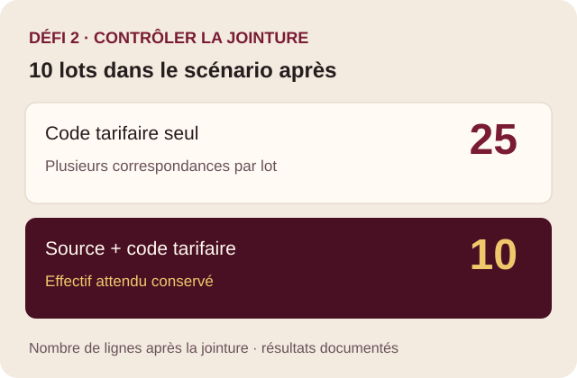
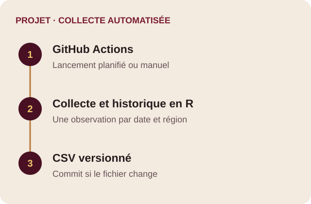

:::: {.realisations-grid}

::: {.realisation-apercu}
## [Défi 2 — vérifier une jointure](defi-2.qmd)

Une analyse en R où le choix d’une clé de jointure change le nombre de lignes et la fiabilité des calculs.

[Découvrir le Défi 2](defi-2.qmd)
:::

::: {.realisation-apercu}
## [Projet — GitHub Actions](github-actions.qmd)

Une contribution au projet d’équipe centrée sur la collecte automatisée et la construction d’un historique.

[Découvrir la collecte](github-actions.qmd)
:::

::::
